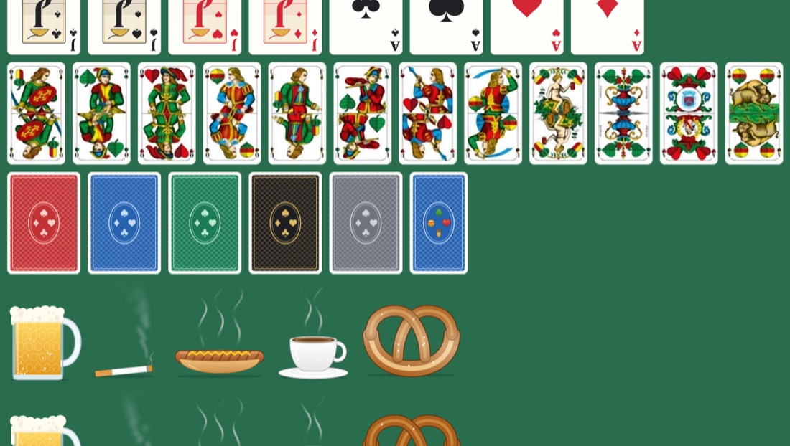

# Wirtshausonmac

Playing cards and pub odds and ends that float above everything: regular apps, browsers and even full-screen apps.



- A French deck for Skat and a Bavarian one for Schafkopf, each with the cards that matter
- Also animated: beer stein, cigarette, bratwurst, coffee and pretzel
- Every card is its own little window. Clicking or dragging one doesn't pull you out of full screen.
- Sizes from 8 to 900 pt, pinch to zoom and turn with two fingers to rotate
- **Lock** (⌃⌥⌘L): clicks go through the cards to the app below
- **On/off** (⌃⌥⌘K), even in full screen
- Typically 11–14 MB of memory and about 5 % CPU per animated thing
- In German when your Mac is set to German, in English otherwise

## Install

1. Download the zip from [Releases](../../releases/latest) and unzip it.
2. Drag `Wirtshausonmac.app` into the Applications folder.
3. Run this once in Terminal, because the app isn't notarized:
   ```sh
   xattr -dr com.apple.quarantine /Applications/Wirtshausonmac.app
   ```
4. Open it.

Requires macOS 14 and runs on Apple silicon and Intel. Step by step: [Install.txt](Install.txt) ([Deutsch](Zum%20Installieren.txt)).

## Build

The Xcode Command Line Tools are enough.

```sh
scripts/build.sh --install   # build a universal app, copy to /Applications, start
scripts/package.sh           # dist/Wirtshausonmac-<version>.zip for sharing
```

`scripts/crop-bavarian.swift` cuts the Bavarian cards in `Resources/bavarian/` out of a picture of the whole deck. Cards without a picture are drawn.

Debug output of the program inside the app bundle: `--snapshot`, `--icon`, `--settings`, `--turned` (each with a PNG path) and `--bench`.

Texts are written in English in the code; the German translations are in `Resources/de.lproj/Localizable.strings`.
